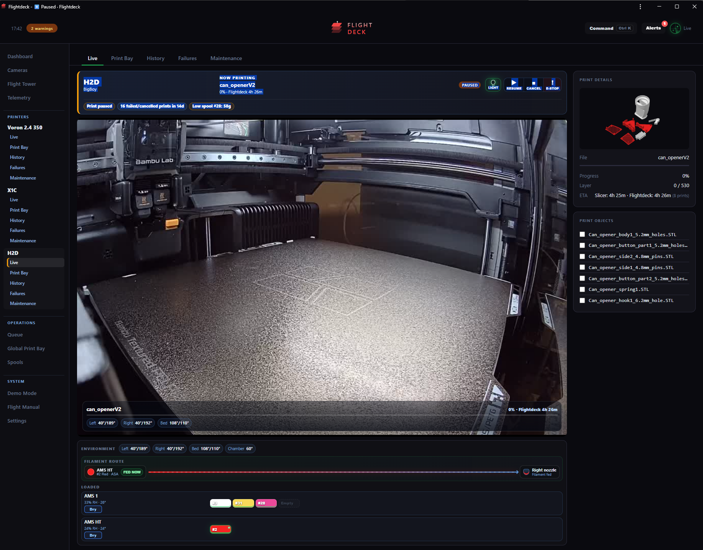
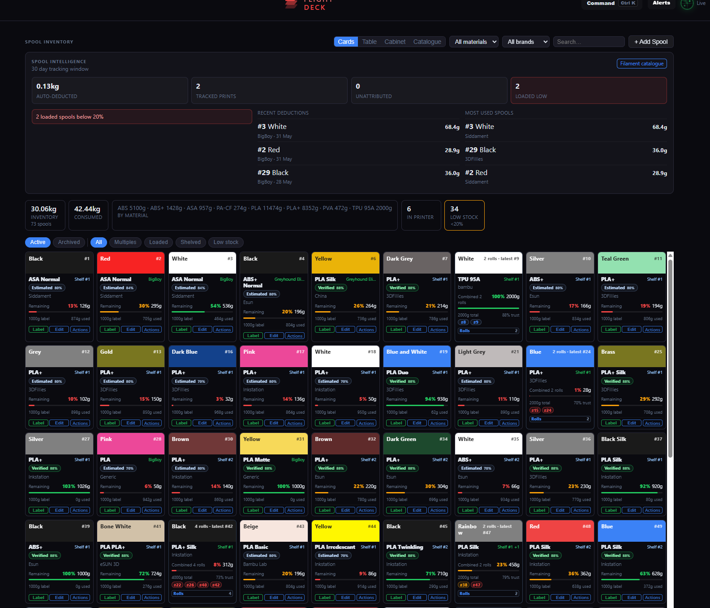
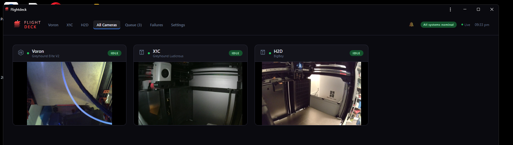

# Flightdeck


Flightdeck is a local-first print operations dashboard for makers running Bambu-heavy printer rooms.

It brings live printer state, cameras, queues, Bambu AMS/AMS HT spool assignment, filament deduction, print history, Print Vault workflows, slicer handoff, maintenance, and recovery tools into one self-hosted interface.

Flightdeck is independent open-source software. It is not affiliated with Bambu Lab, Voron, Klipper, OrcaSlicer, or any slicer/printer vendor.

## Beta Scope

This beta is deliberately narrow:

- Tested hardest with Bambu Lab printers, especially X1C and H2D.
- Built around AMS, AMS HT, spool tracking, queue/reprint, live camera, and print-history workflows.
- Voron/Klipper support exists, but the beta promise is Bambu-first.
- Windows install and Windows browser slicer helpers exist, but Raspberry Pi is the recommended host for first testers.
- Do not expose Flightdeck directly to the public internet. Use LAN or Tailscale.

If you want the most stable first test, use a Raspberry Pi 5 and one Bambu printer with AMS.

## What Flightdeck Does

- Live printer dashboard with camera-first printer pages.
- Fleet Wall for shop-floor camera and status monitoring.
- Flight Tower for queue readiness, blocked jobs, and operator attention.
- Bambu queue/reprint flows and Print Vault file staging.
- AMS/AMS HT visual loadout and filament route tracking.
- Spool inventory with swatch, detail, table, cabinet, label, and QR assignment flows.
- Automatic filament deduction when Flightdeck can match the print to an assigned spool.
- Print history with notes, spool usage correction, and Flight Recorder attachment slots.
- Setup health, diagnostics bundle, safe restart, and camera worker recovery tools.
- Optional Windows OrcaSlicer/Bambu Studio browser slicers and desktop Orca handoff.

## Screenshots







## Install

Start here:

- [Raspberry Pi install](docs/INSTALL_PI.md)
- [Windows slicer worker and browser slicers](docs/WINDOWS_SLICER_WORKER.md)
- [Troubleshooting](docs/TROUBLESHOOTING.md)
- [Beta limitations](docs/BETA_LIMITATIONS.md)

Quick Pi install:

```bash
curl -fsSL https://raw.githubusercontent.com/Kidabah/flightdeck/main/scripts/install-pi.sh | bash
```

Then open Flightdeck and follow the first-run path:

1. Add printers from `System -> Settings -> Printers`.
2. Add shelves/locations and spools from `Spools`.
3. Assign spools to AMS/AMS HT slots.
4. Queue or reprint a small Bambu job and confirm print history/spool deduction.

## Windows Install

Flightdeck can also run as a Windows tray app:

```powershell
.\Install-Flightdeck-Windows.cmd
```

Windows is useful when you want the slicer worker and browser slicer containers on the same machine as OrcaSlicer/Bambu Studio. For a simple always-on shop host, start with the Pi install.

On Windows, labels print through the Brother QL-700 or AusPrint Pro Windows printer queue (set `FLIGHTDECK_LABEL_PRINTER_MODEL` to `brother_ql` or `ausprint_pro` and `FLIGHTDECK_LABEL_PRINTER_NAME` to the queue name) and the Dymo scale is read over HID. Details in [`INSTALL.md`](INSTALL.md#optional-hardware).

## Optional Hardware

Flightdeck does not require extra hardware, but these are the currently tested shop-floor helpers:

| Hardware | Current beta use |
| --- | --- |
| Dymo USB postal scale | Read spool weight for correction/reconcile workflows |
| Brother QL-700 label printer | Print spool QR labels on DK-22212 continuous labels |

Use `System -> Settings -> Hardware` and `System -> Settings -> Setup` to check whether Flightdeck can see connected USB hardware. On Windows, QL-700 printing may need a WinUSB/libusb driver through Zadig; on Pi, connect the scale/label printer directly to the host when possible.

## Updating

From the Flightdeck repo folder:

```bash
git pull
./scripts/install.sh
sudo ./scripts/safe-restart-flightdeck.sh
```

Live data is stored outside the git checkout by default, usually in:

```text
~/flightdeck-data
```

That keeps printer config, history, spools, uploads, and the print vault away from app updates.

## Backup and Restore

Create a backup:

```bash
./scripts/backup-flightdeck-data.sh
```

Include the print vault:

```bash
INCLUDE_PRINT_LIBRARY=1 ./scripts/backup-flightdeck-data.sh
```

Restore:

```bash
sudo systemctl stop flightdeck.service
./scripts/restore-flightdeck-data.sh ~/flightdeck-backup-private/backups/flightdeck-backup-YYYYmmdd-HHMMSS.tar.gz
sudo ./scripts/safe-restart-flightdeck.sh
```

The restore helper asks for confirmation and makes a safety copy before replacing live data.

## Safe Restart

If the service or camera workers get stuck:

```bash
sudo ./scripts/safe-restart-flightdeck.sh
```

If only Bambu camera feeds are misbehaving:

```bash
./scripts/clear-camera-workers.sh
```

## Release Notes

Current beta notes:

- [v0.4.0-beta.1](docs/releases/v0.4.0-beta.1.md)

## Support

Flightdeck is free and open source. If it helps your shop, support is appreciated:

[Support Flightdeck on Ko-fi](https://ko-fi.com/flightdeck3dprinters)

## Acknowledgements

- The Voron, Klipper, and Moonraker communities for keeping the open ecosystem alive.
- [`bambulabs-api`](https://github.com/mchrisgm/bambulabs_api) for making the Bambu side approachable.
- [`Bambuddy`](https://github.com/maziggy/bambuddy) for documenting and validating Bambu AMS/AMS-HT protocol behaviour in the open.
- Steve Keen for practical shop-floor and staff workflow feedback.

## License

Flightdeck source code is licensed under the GNU Affero General Public License v3.0 or later. See [LICENSE](LICENSE).

The Flightdeck name, logo, icon, wordmark, and project branding are not granted for reuse by the code license. See [TRADEMARK.md](TRADEMARK.md).
